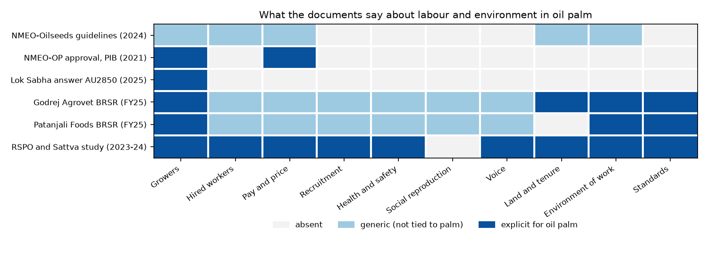

# Labour in the paperwork of India's oil palm push

**What policy and corporate documents show about labour on India's oil palm frontier, and what they leave to fieldwork**

Nikhil Sehgal · Independent desk study · November 2026 · Code and coded data: github.com/nikhilsehgal3333/oilpalm-labour-paperwork

## 1. Why read the paperwork

In August 2021 the Government of India approved the National Mission on Edible Oils - Oil Palm
(NMEO-OP), "a new Centrally Sponsored Scheme with a special focus on the North east region and the
Andaman and Nicobar Islands". The mission proposed to cover "an additional area of 6.5 lakh hectare
(ha.) for oil palm till the year 2025-26" and introduced a Viability Price for the fresh fruit
bunches that growers sell to processors (PIB 2021). By 31 March 2025, 68,324 ha in the North-Eastern
Region had been brought under oil palm, with a target of 92,543 ha for 2025-26; the region had "two
operational mills in Arunachal Pradesh and one in Mizoram", and a new mill was approved for Assam
(Lok Sabha 2025, pp. 1-2). Private processors carry much of this expansion. Godrej Agrovet and
Patanjali Foods both report oil palm operations that depend on fresh fruit bunches bought from
growers.

A frontier of this kind produces paperwork before it produces much research: mission documents,
parliamentary answers, sustainability reports of listed companies, and studies commissioned by
certification bodies. This paperwork is also how the expansion is presented to investors,
regulators and buyers. Pye (2019, p. 218) argues that certification "fetishes the commodity palm
oil", while what needs to become sustainable is "the social relations of nature in the production of
the commodity". His work with migrant plantation workers in Malaysia shows how labour is fragmented
and made precarious, and how workers pursue their own strategies of social reproduction (Pye 2017).
These arguments suggest a simple test for the Indian case: when the documents behind the oil palm
push describe the people who produce palm oil, whom do they see, and what do they say about their
work and its environment?

This desk study asks: **how do the policy documents of NMEO-OP and the sustainability disclosures of
the processors expanding into North-East India represent labour (on plantations, in mills and in
social reproduction) and its link to the environment, and what do they leave out that only fieldwork
with workers can show?** It is a precursor to fieldwork, not a substitute for it.

## 2. Corpus and method

**Corpus.** Six public documents (Table A1): the Ministry of Agriculture release on the Cabinet
approval of NMEO-OP (PIB 2021); Lok Sabha unstarred question 2850 on palm oil in the North-Eastern
Region (Lok Sabha 2025); the Business Responsibility and Sustainability Reports (BRSR) of Godrej
Agrovet and Patanjali Foods for FY2024-25; the RSPO and Sattva smallholder diagnostic study of the
oil palm landscape in Assam and Andhra Pradesh (Sattva Consulting 2023-24); and, as context, the 2024
operational guidelines of the sister mission for annual oilseeds, NMEO-Oilseeds (MoAFW 2024). BRSR
is the sustainability report that SEBI requires of large listed companies in India. The two
processors were chosen because both report oil palm plantation and mill operations and North-East
agreements; AWL Agri Business was left out because it mainly imports and refines palm oil.

**Codebook.** Ten codes, taken deductively from the literatures named in the PALMWORK project:
labour regime analysis, feminist labour geography, environmental labour studies and political
ecology. Labour codes: growers; hired workers on plantations, farms and in mills; pay and price;
recruitment and control; health and safety; social reproduction (housing, health care, care work,
schooling, water); and voice (unions, associations, grievance mechanisms). Environment codes: land
and tenure; the environment of work (water, soil, heat, chemicals). One code for standards and
certification. "Who works" was split into growers and hired workers after the first round of coding,
because labour regime analysis separates growers on their own land from wage workers.

**Levels.** For each document and code: *explicit* (the document says something about the code for
oil palm work, workers, growers or places), *generic* (it addresses the code company-wide or
scheme-wide, without tying it to oil palm), or *absent*.

**Procedure.** A keyword search found candidate passages for each code. Each candidate was read and
coded under the codebook (directed qualitative content analysis; Hsieh and Shannon 2005). A first
review proposed a level for each passage, and the author checked every passage that decides the
level of a cell. Every coded passage carries a page reference, and all changes to the
plan are logged with their reasons. The full pipeline reruns with one command.

## 3. What the paperwork shows

<!-- RESULTS:START -->

*Generated by `run_all.py` from `results/`. Do not edit by hand.*

- Documents: 6; codes: 10; cells: 60.
- Candidate passages found by keyword: 567; passages coded: 120, of which 36 checked by the author.
- Cells: 19 explicit for oil palm, 17 generic, 24 absent. Deciding passage checked by the author in 36 of 36 non-empty cells.
- Growers are named in an oil palm context in 5 of 6 documents; hired workers in 1; social reproduction in 0.
- In the two BRSRs, 12 of 12 cells on hired labour (hired workers, pay, recruitment, safety, social reproduction, voice) are generic: company-wide, not tied to oil palm.

| Document | Growers | Hired workers | Pay and price | Recruitment | Health and safety | Social reproduction | Voice | Land and tenure | Environment of work | Standards |
|---|---|---|---|---|---|---|---|---|---|---|
| NMEO-Oilseeds guidelines (2024) | generic | generic | generic | - | - | - | - | generic | generic | - |
| NMEO-OP approval, PIB (2021) | palm | - | palm | - | - | - | - | - | - | - |
| Lok Sabha answer AU2850 (2025) | palm | - | - | - | - | - | - | - | - | - |
| Godrej Agrovet BRSR (FY25) | palm | generic | generic | generic | generic | generic | generic | palm | palm | palm |
| Patanjali Foods BRSR (FY25) | palm | generic | generic | generic | generic | generic | generic | - | palm | palm |
| RSPO and Sattva study (2023-24) | palm | palm | palm | palm | palm | - | palm | palm | palm | palm |

<!-- RESULTS:END -->

**3.1 Growers are everywhere; hired workers almost nowhere.** Every oil palm document in the corpus
names growers: as beneficiaries of the Viability Price (PIB 2021), as the people the North-East
mission expansion is meant "to benefit" (Lok Sabha 2025, p. 2), as smallholders who supply fresh fruit
bunches (Godrej, PDF pp. 18, 40, 42; Patanjali, PDF pp. 7-8, 11). Patanjali reports that it bought
fresh fruit bunches "from 63,915 farmers" (PDF p. 8). By contrast, neither policy document mentions
the people hired to work on oil palm farms, plantations or in mills. The only document that
describes hired oil palm labour is the RSPO and Sattva study, and it does so through the growers who
hire it.

**3.2 Company reports disclose labour for the company, not for palm.** Both BRSRs report detailed
workforce data, but for the company as a whole. Godrej Agrovet reports 884 permanent and 2,817 "other
than permanent" workers (PDF p. 4); Patanjali Foods reports 1,614 permanent and 14,207 other than
permanent workers (PDF p. 3). The reports do not say how many of these workers are employed in oil
palm, on plantations, in mills or in the North-East. Wages, safety indicators, health and maternity
benefits, and grievance mechanisms are all reported in the same company-wide way, and the health and
safety systems are described for the company's sites in general (Godrej: "across its manufacturing
locations, research facilities and offices", PDF p. 24; Patanjali: "All our locations", PDF p. 15). Every hired-labour code in both reports is
therefore generic. The large share of workers on non-permanent terms is visible; where they work, and
whether they work in oil palm, is not.

**3.3 Where palm appears in the company reports, it appears as growers, water and certification.**
Oil palm becomes explicit in the BRSRs in three places: the growers who supply fresh fruit bunches
(Godrej procures them "from farmers across Government-allocated districts", which account for more
than 90% of its input costs, PDF p. 18); environmental management (drip irrigation, treatment of mill
effluent, use of empty fruit bunches); and certification (Godrej's verification under the Indian
Palm Oil Sustainability Framework, PDF p. 18; RSPO among Patanjali's certifications, PDF p. 7). The
North-East is nearly invisible. Godrej's BRSR names no North-Eastern state. Patanjali's names one
place: it "commissioned" a modern oil palm mill in Niglok, Arunachal Pradesh (PDF p. 11). The
environment enters these reports as resource management; it does not enter as a condition of work.

**3.4 The certification study sees hired labour through the grower's eyes.** The RSPO and Sattva
study is grower-centred, but it is the only document that describes the work itself. In Assam, 73%
of the farmers surveyed "hire only men" and 2% hire only women (PDF p. 54). External labour is
"largely local contractual workers and not migrant" in Assam (91%) and Andhra Pradesh (71%) (PDF p.
54). A grower in West Godavari, Andhra Pradesh, explains: "We hire women labourers only for cleaning activities in the
field ... for other activities like harvesting and loading of bunches ... they are not suitable" (PDF
p. 54). The study also records the economic pressure on growers: in Goalpara, Assam, farmers in focus
groups "reported receiving as less as Rs 5 per kg" through intermediaries (PDF p. 27), and "only 31%
of farmers in Assam have land titles or documents signifying ownership" (PDF p. 42). It notes that the
mission's implementation "is unable to address granular and region-specific risks" such as
biodiversity loss, water shortages and impacts on indigenous communities (PDF p. 10). Workers'
wages, conditions and housing are not part of its diagnostic.

**3.5 Social reproduction is the blank column.** No document links housing, care work, health care,
schooling, water or food to oil palm work or oil palm households. The BRSRs report health insurance,
maternity benefits and day care for their own employees and workers in general; the policy
documents and the certification study are silent. The NMEO-Oilseeds guidelines, the context
document, rely on women community workers (Krishi Sakhis) to collect mission data (MoAFW 2024, PDF
pp. 28, 35), a
reminder that the mission machinery itself runs partly on women's community labour.

## 4. What the paperwork leaves to fieldwork

Read together, the documents describe India's oil palm push as a relation between the state,
processors and growers. Hired labour on farms, plantations and in mills, the gendered division of that
labour, and the households that sustain it remain outside the frame. This is the space the PALMWORK
project addresses. The desk study suggests questions that only fieldwork with workers in the
North-East can answer:

1. **Who is hired, and on what terms?** On smallholdings, company nurseries and plantations in Assam,
   Arunachal Pradesh and Mizoram: local contract workers, family members or migrants; daily rates or
   piece rates per bunch; who recruits them.
2. **Who works in the mills?** At the mills in Arunachal Pradesh (including Niglok) and Mizoram:
   permanent or contract status, shifts, and safety around sterilisers, boilers and effluent.
3. **How is the work divided by gender?** Why harvesting and loading are coded as men's work, what
   women do (cleaning, weeding, nursery work), and at what pay.
4. **How does oil palm reorganise social reproduction?** Housing, water, food and care in households
   where oil palm replaces food crops or shifting cultivation, and how household labour is
   reallocated across the long gestation period before the first harvest.
5. **What is the environment of the work?** Pesticide handling where growers lack training (the
   RSPO study notes knowledge gaps, PDF p. 35), heat, thorns and water stress.
6. **Who speaks for workers?** Whether growers' associations and Farmer Producer Organizations
   represent hired workers, or only growers.

## 5. Limits

Documents show what organisations choose to say: absence in a document is not absence on the
ground. BRSR is designed for a company's own workforce, so it cannot be expected to cover workers
employed by growers or contractors; its silence on palm-specific labour is a finding about the
reporting format as much as about the companies. The NMEO-OP operational guidelines could not be
included: the government servers refused downloads, and the 2024 guidelines available to the author
are those of the oilseeds mission, which does not cover oil palm. The corpus holds six documents in
English, from one financial year for the companies. Keyword search can miss passages that use other
words; codes rest on the passages found and read. There was one coder: the author checked every
deciding passage, but no second, independent coder assessed reliability. The study is a learning exercise that shows a
method and a gap. It does not measure labour conditions.

## References

Hsieh, H.-F. and Shannon, S. E. (2005). Three approaches to qualitative content analysis.
*Qualitative Health Research*, 15(9), 1277-1288. https://doi.org/10.1177/1049732305276687

Godrej Agrovet Ltd (2025). *Business Responsibility and Sustainability Report, FY2024-25*. NSE filing.

Lok Sabha (2025). Unstarred Question No. 2850, Development of Palm Oil, Agarwood and Bamboo in NER,
answered 17 December 2025. Ministry of Development of North Eastern Region.

MoAFW, Ministry of Agriculture and Farmers' Welfare (2024). *Operational Guidelines: National Mission
on Edible Oil - Oilseed (NMEO-OS)*.

Patanjali Foods Ltd (2025). *Business Responsibility and Sustainability Report*, in Integrated Annual
Report 2024-25.

PIB, Press Information Bureau (2021). Cabinet approves implementation of National Mission on Edible
Oils - Oil Palm. Ministry of Agriculture and Farmers Welfare, 18 August 2021, PRID 1746943.

Pye, O. (2017). A plantation precariat: Fragmentation and organizing potential in the palm oil
global production network. *Development and Change*, 48(5), 942-964. https://doi.org/10.1111/dech.12334

Pye, O. (2019). Commodifying sustainability: Development, nature and politics in the palm oil
industry. *World Development*, 121, 218-228. https://doi.org/10.1016/j.worlddev.2018.02.014

Sattva Consulting (2023-24). *Smallholder Diagnostic Study of the Oil Palm Landscape in India* (Assam
and Andhra Pradesh). Roundtable on Sustainable Palm Oil.

## Appendix: Table A1, corpus

| Document | Owner | Pages | Role |
|---|---|---|---|
| NMEO-OP approval release, 18 Aug 2021 | PIB, Ministry of Agriculture | 1 (web) | national policy |
| Lok Sabha unstarred question 2850, 17 Dec 2025 | Ministry of DoNER | 3 | North-East status |
| BRSR FY2024-25 | Godrej Agrovet | 44 | processor disclosure |
| BRSR FY2024-25 | Patanjali Foods | 32 | processor disclosure |
| Smallholder diagnostic study | RSPO and Sattva Consulting | 65 | certification study |
| NMEO-Oilseeds operational guidelines, 2024 | Ministry of Agriculture | 50 | context (sister mission) |

Page references are PDF pages. Addresses and SHA-256 values of all files are in
`data/corpus.csv` and `data/corpus_lock.csv`.
