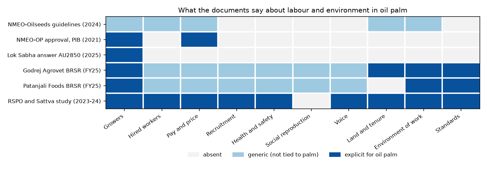

# Labour in the paperwork of India's oil palm push

**Version 0.1 (November 2026).** An independent desk study by Nikhil Sehgal, using public documents
only. It is not an output of the University of Bonn, the PALMWORK project or any company named.

- Note (4 pages): [`NOTE.md`](NOTE.md) and [`NOTE.pdf`](NOTE.pdf)
- Results page: https://oilpalm-labour-paperwork.vercel.app

## Question

How do the policy documents of India's National Mission on Edible Oils - Oil Palm (NMEO-OP, 2021)
and the sustainability disclosures of the processors expanding into North-East India represent
labour (on plantations, in mills and in social reproduction) and its link to the environment? What
do they leave out that only fieldwork with workers can show?

## Results

<!-- RESULTS:START -->

*Generated by `run_all.py` from `results/`. Do not edit by hand.*

- Documents: 6; codes: 10; cells: 60.
- Candidate passages found by keyword: 567; passages coded: 120, of which 36 checked by the author.
- Cells: 19 explicit for oil palm, 17 generic, 24 absent. Deciding passage checked by the author in 36 of 36 non-empty cells.
- Growers are named in an oil palm context in 5 of 6 documents; hired workers in 1; social reproduction in 0.
- In the two BRSRs, 12 of 12 cells on hired labour (hired workers, pay, recruitment, safety, social reproduction, voice) are generic: company-wide, not tied to oil palm.

| Document | Growers | Hired workers | Pay and price | Recruitment | Health and safety | Social reproduction | Voice | Land and tenure | Environment of work | Standards |
|---|---|---|---|---|---|---|---|---|---|---|
| NMEO-Oilseeds guidelines (2024) | generic | generic | generic | - | - | - | - | generic | generic | - |
| NMEO-OP approval, PIB (2021) | palm | - | palm | - | - | - | - | - | - | - |
| Lok Sabha answer AU2850 (2025) | palm | - | - | - | - | - | - | - | - | - |
| Godrej Agrovet BRSR (FY25) | palm | generic | generic | generic | generic | generic | generic | palm | palm | palm |
| Patanjali Foods BRSR (FY25) | palm | generic | generic | generic | generic | generic | generic | - | palm | palm |
| RSPO and Sattva study (2023-24) | palm | palm | palm | palm | palm | - | palm | palm | palm | palm |

<!-- RESULTS:END -->

## Process

The study follows one path from documents to findings. Every step leaves a file.

1. **Corpus.** `data/corpus.csv` lists six public documents. `run_all.py` downloads them into
   `local/` (not published), records size, page count and SHA-256 in `data/corpus_lock.csv`, and
   extracts the text page by page. A run stops if a file no longer matches the lock.
2. **Codebook.** `codebook.yaml` holds ten codes taken from labour regime analysis, feminist labour
   geography, environmental labour studies and political ecology, with three levels per document
   and code: explicit for oil palm, generic, absent.
3. **Candidates.** A keyword search finds candidate passages for each code
   (`results/candidate_counts.csv`). Keywords only find candidates; they decide nothing.
4. **Coding.** For each document and code, the best candidates go to a coding sheet. The keyword
   rule proposes a level, a first review corrects it, and the author checks it. The author checked
   every passage that decides the level of a cell. `results/coding_log.csv` records all three steps
   for every row, without the document text.
5. **Results.** `results/coded_passages.csv` (short excerpts with page references),
   `results/presence_matrix.csv`, the figure, and `results/manifest.json`, from which every number
   above is written.
6. **Changes.** Every change to the plan, with date and reason, is in [`DEVIATIONS.md`](DEVIATIONS.md).

## Reproduce

    uv sync
    uv run python run_all.py            # fetch, lock, extract, code, report, site
    uv run python run_all.py --offline  # rebuild from local/ only
    uv run pytest
    uv run python scripts/build_pdf.py  # NOTE.pdf (needs Chrome or Edge)

The documents belong to their owners and are not in this repository. Three servers refuse scripted
downloads (column `manual` in `data/corpus.csv`): save those files by hand from a browser as
`local/corpus/<id>.pdf`. The coding sheet with the full passages stays in `local/`; the published
coding log and excerpts let anyone trace each code to a page.

## Layout

    data/            corpus list and lock
    codebook.yaml    codes, levels, keywords
    src/oilpalm_paperwork/   corpus, kwic (candidates), coding, report
    scripts/         first-review records, check merging, PDF build
    results/         all outputs, written by the scripts
    site/            results page (Vercel)
    tests/           unit and integrity tests

## Limits

Documents show what organisations choose to say. The NMEO-OP operational guidelines could not be
included. One coder. Six documents, English only. See section 5 of the note.

## Licence

Code: MIT. Excerpts from the documents are short quotations with page references.
